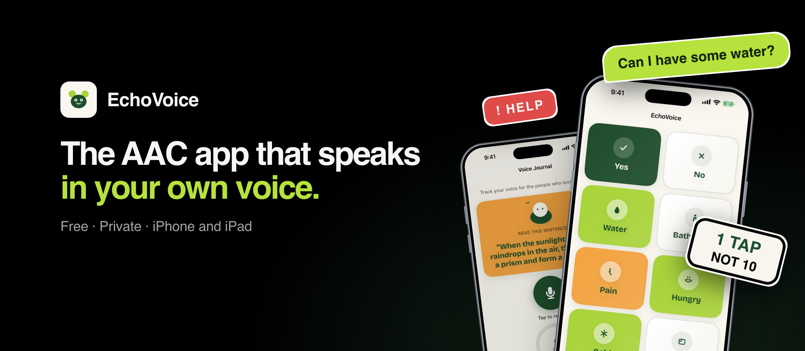
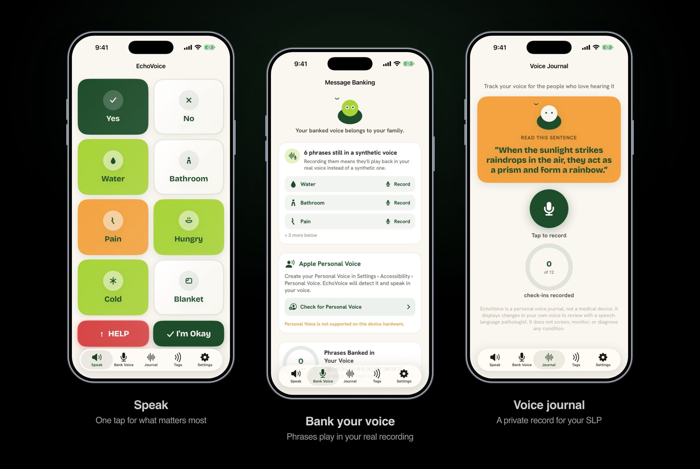

<p align="center">
  
</p>

<p align="center">
  <strong>Say what matters. In your own voice.</strong><br>
  A free, private communication app for people losing reliable speech.
</p>

<p align="center">
  <a href="https://ayaanrustagi.github.io/echovoice/"><strong>Website</strong></a> &nbsp;·&nbsp;
  <a href="https://ayaanrustagi.github.io/echovoice/install/"><strong>Install</strong></a> &nbsp;·&nbsp;
  <a href="#build-from-source">Build from source</a> &nbsp;·&nbsp;
  <a href="PRIVACY_POLICY.md">Privacy</a>
</p>

<p align="center">
  
  
  
  
  
</p>

<br>

<p align="center">
  
</p>

<br>

EchoVoice is an AAC (augmentative and alternative communication) app for adults living with ALS, MND, stroke, Parkinson's, or aphasia. The words you need most are one tap away, new sentences are a few more, and the phrases that matter can play back in a recording of your own voice.

Built by **Ayaan, Charan and Sree** at Rouse High School in Leander, Texas, after one of our grandfathers lost his voice to motor neuron disease. No account, no ads, and no EchoVoice server.

## What's inside

| | |
| :--- | :--- |
| **Quick · Build · Type** | One-tap phrases, a core-word sentence builder built on Project Core's Universal Core, and the full keyboard. A sentence started in Build carries into Type. |
| **Your own voice** | Record phrases while you still can. Tapping them later plays your real recording. Apple Personal Voice covers everything else. |
| **Hands-free access** | Head tracking and eye gaze on TrueDepth devices, dwell selection, and five quick blinks to call for help. |
| **Voice journal** | Read one sentence each week. Speaking rate, pauses and pitch are measured on the device and compared only with your own earlier readings. Export a PDF or CSV for your speech-language pathologist. |
| **Everywhere you are** | NFC phrase tags, Siri, Shortcuts and the Action Button, a partner-facing display, and board lock. |
| **Built for iPad** | Adaptive layouts with up to 64 phrases per page, where every word keeps its place. |

> [!NOTE]
> EchoVoice is not a medical device. It does not diagnose, screen, or monitor any condition, and it is not a substitute for an AAC evaluation by a speech-language pathologist.

## Private by design

- **Nothing leaves the phone.** Speech analysis, suggestions, and gaze tracking all run on the device. Camera frames are never stored.
- **No account, no analytics, no tracking.** There is no EchoVoice server to send anything to.
- **Your recordings are yours.** Export a backup file your family keeps, any time.

Full details in the [privacy policy](PRIVACY_POLICY.md).

## Get EchoVoice

Download **`EchoVoice.ipa`** from **[Releases](https://github.com/ayaanrustagi/echovoice/releases/latest)** and install it with your own Apple ID using [Sideloadly](https://sideloadly.io). Step-by-step instructions are on the **[install page](https://ayaanrustagi.github.io/echovoice/install/)**.

> [!IMPORTANT]
> With a free Apple ID, sideloaded apps stop opening after 7 days. Reinstall with Sideloadly to renew. NFC phrase tags may not work in sideloaded builds.

The App Store release is in progress. If you'd rather not sideload, **[email us](mailto:ayaan.rustagi2010@gmail.com?subject=EchoVoice%20beta)** for a TestFlight invite. Speech-language pathologists and AT specialists who want to review the app are especially welcome.

## Repository

| Path | What it is |
| :--- | :--- |
| [`EchoVoice/`](EchoVoice/) | The iOS and iPadOS app (SwiftUI, SwiftData, AVFoundation, ARKit, Core NFC, App Intents) |
| [`Tests/`](Tests/) | Logic tests as standalone Swift executables. No simulator or signing needed. |
| [`Scripts/`](Scripts/) | Test runners and the localization checker |
| [`docs/`](docs/) | The website, served with GitHub Pages |
| [`notes/`](notes/) | Design notes for the iPad layouts and the Spanish localization |

## Build from source

You need a Mac with **Xcode 26 or later**. The app targets **iOS 17**. Some features need newer hardware or OS versions: eye gaze needs a TrueDepth camera, and on-device sentence suggestions need Apple Intelligence (iOS 26).

```sh
git clone https://github.com/ayaanrustagi/echovoice.git
cd echovoice
open EchoVoice.xcodeproj
```

In Xcode, choose your own team under **Signing & Capabilities**, then run on a device or simulator. Hardware features like eye gaze, NFC, and Personal Voice can't be fully tested in the Simulator.

Run the logic tests from the terminal:

```sh
./Scripts/run_tests.sh
./Scripts/run_localization_tests.sh
```

---

<p align="center">
  <br>
  <a href="LICENSE">MIT License</a> &nbsp;·&nbsp;
  <a href="PRIVACY_POLICY.md">Privacy policy</a> &nbsp;·&nbsp;
  <a href="NOTICE">Credits</a>
</p>
